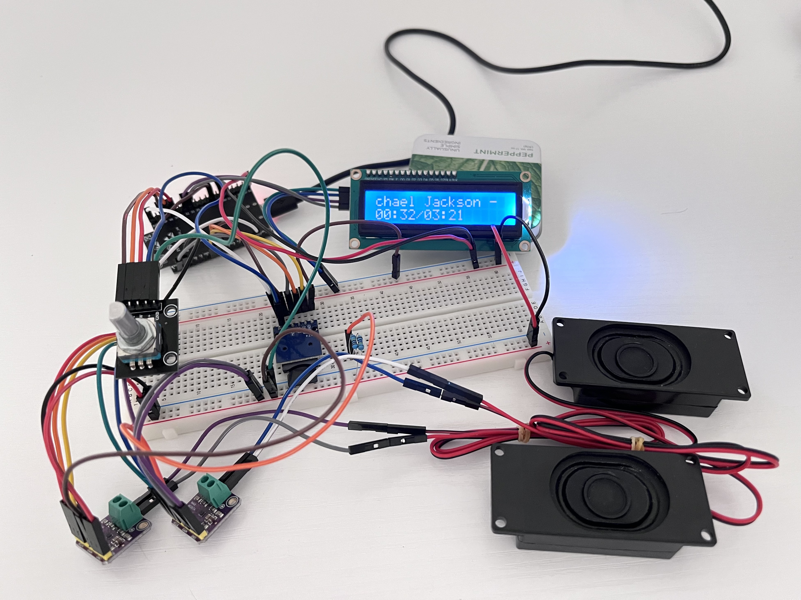
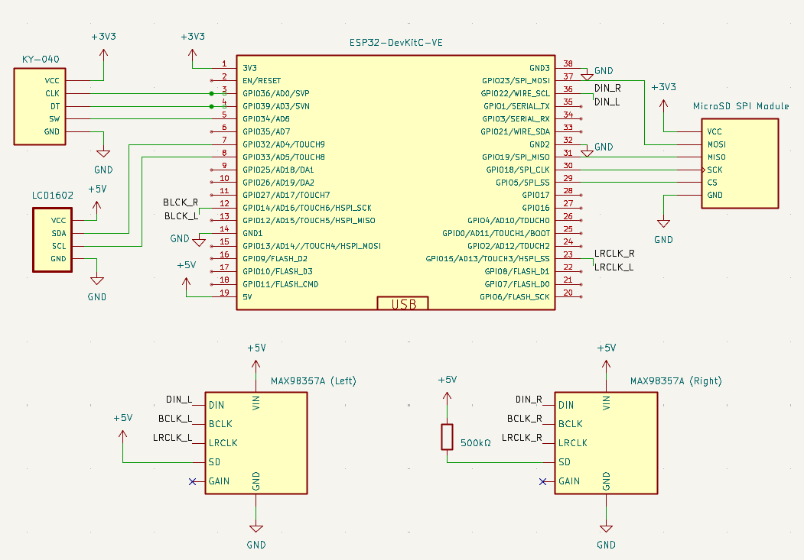

# ESP32 MP3 Player

A simple MP3 player!



## Demo
[Check it out on youtube :)](https://youtu.be/1Ke2b3DL_yw)

## Some highlights
- High capacity storage support (64GB+)
- File system that lets you select songs/folders
- Play/pause, next song, return, and volume controls

## How it works

### File system
I used the Arduino SdFat library to read MP3 files stored in a microSD card. The file system  is exFAT formatted to handle large microSD sizes, since <64GB microSD cards use the older FAT32 standard.

### Audio decoding
I used Arduino Audio Tools library to decode MP3 PCM signals into raw bitstreams. Then I2S is used to send the bitstream into a hardware DAC/AMP module that sends the audio to the speakers.

### Playback
All controls are handled through a single rotary encoder that includes a built-in button. I used FSMs to debounce encoder turns and detect different button presses.

## Hardware components

These are the parts you'll need if you want to build it! This is also listed in the BOM.

| Component | Part | Qty |
|:-----|:-------|:-------|
| MCU    |   ESP32-DEVKITC-VE    | 1
| Control    | KY-040      | 1
| DAC/AMP    | MAX98357a    | 2
| Display    | LCD1602 (w/ I2C backpack)    | 1
| Storage    | MicroSD Module  (SPI)   | 1
| Output    | 4/8 Ohm Speakers      | 2

## Wiring diagram


## How to flash


### Option 1. Manual setup w/ Arduino IDE
1. Install [Arduino IDE](https://www.arduino.cc/en/software) 

2. Clone or download this repository, and open the .ino file

4. Install the board package: **esp32 by Espressif Systems**

5. Select the board: **ESP32 Dev Module**

6. Under Tools, select these configurations:
    - Flash Size: 8 MB
    - Partition Scheme: 8M with SPIFFS

7. Install these Arduino libraries:
    - [SdFat by Bill Greiman](https://github.com/greiman/sdfat)
    - [Audio Tools by Phil Schatzmann](https://github.com/pschatzmann/arduino-audio-tools/tree/main)
    - [LibHelix by Phil Schatzmann](https://github.com/pschatzmann/arduino-libhelix) 
    - [LiquidCrystal_I2C by Martin Kubovcik, Frank de Brabander](https://github.com/markub3327/LiquidCrystal_I2C)


### Option 2. Using the pre-complied binary
1. Install [esptool](https://docs.espressif.com/projects/esptool/en/latest/esp32/):
    ```
    pip install esptool
    ```

2. Download the .bin files from the latest Github Release

3. Inside the directory containing the downloaded .bin files, run:
    ```
    esptool --chip esp32 write-flash 0x1000 esp32_mp3_player.ino.bootloader.bin 0x8000 esp32_mp3_player.ino.partitions.bin 0x10000 esp32_mp3_player.ino.bin
    ```